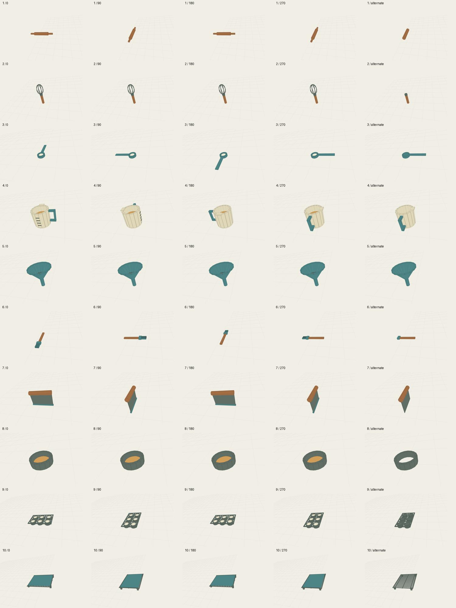
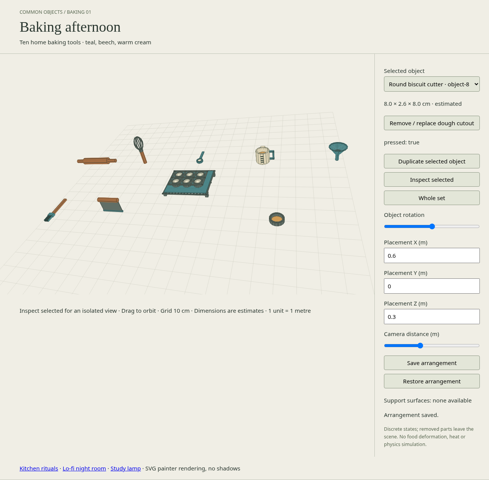

# Baking afternoon · 2026-10-31 04:00 KST

Ten original home baking tools, authored from estimated everyday proportions, with no manufacturer measurements claimed. Starting remote main: `8b79cb6c8e7fbaa8d17e24a17273fedb99ca1a57` (90 catalog entries). Catalog now contains 100 entries, including the inherited room assembly and component groups.

## Sources and dimensions

Reproduce with `node scripts/batches/baking-2026-10-31.mjs`. JSON geometry and SVG thumbnails are under `assets/baking-*/`; the shared renderer is `renderer/svg.js`, and `preview/baking.html` uses the reusable `preview/metric-batch.js` player. New objects are distinct tools, not color variants.

| Object | Estimated X × Y × Z (cm) | Independent action |
|---|---|---|
| Handled rolling pin | 40.00 × 5.40 × 5.40 | Remove / replace end handles |
| Balloon wire whisk | 7.24 × 24.94 × 7.24 | Detach / attach wire head |
| Tablespoon measure | 4.80 × 1.70 × 14.55 | Empty / fill flour measure |
| Graduated measuring jug | 12.40 × 9.30 × 9.90 | Empty / fill jug |
| Wide mouth kitchen funnel | 10.79 × 10.40 × 10.79 | Remove / replace strainer insert |
| Silicone pastry brush | 4.00 × 1.80 × 23.00 | Detach / attach brush head |
| Bench dough scraper | 15.40 × 11.70 × 2.80 | Remove / replace blade guard |
| Round biscuit cutter | 8.00 × 2.60 × 8.00 | Remove / replace dough cutout |
| Six cup muffin tin | 24.80 × 3.50 × 15.80 | Remove / replace paper liners |
| Raised wire cooling rack | 32.00 × 3.60 × 26.60 | Remove / replace cooling mat |

Every source records exact rest geometry bounds, conservative clearance footprint, support metadata (empty where none certified), stable part IDs, local pivots and reference axes, fixed joints, estimated measurement provenance, instance state and default scale [1,1,1]. All geometry is Y-up metres, centered on ground contact; camera fitting changes distance only. Removed components leave the scene; no hinge motion is implied.

## Verification

Evidence: `baking-validation-result.json`, `baking-browser-result.json`, `baking-test-result.txt` and `screenshots/baking-2026-10-31/`. Four cardinal orientations plus alternate state are captured for each tool. Browser checks cover independent duplicates, 20-instance mixed scene save/restore, exact 0.036 m support placement of muffin tin on the cooling mat, multi-object occlusion, zoom, orbit, selection and 390px viewport overflow.

## Limits

Projected SVG geometry, not GLB or a physics simulation. Sizes are design estimates. Cylindrical walls and wire loops are faceted; the measuring jug is opaque. Funnel uses an open-ended, zero-thickness frustum shell and its strainer is removable. Tools are displayed in canonical resting orientations, with no stability simulation. Rack support is certified only with its mat fitted. No heat, dough deformation, flowing liquid, mechanical articulation, shadows or load limits are simulated. Low-end device performance is not certified.

## Final outcome

**10 of 10 accepted; catalog total 100.** Final `npm run validate`, `node scripts/baking-check.mjs`, `npm test` (47 passed, 0 failed) and `npm run build` passed. Final Chromium run of `python3 scripts/baking-browser-check.py` passed all 13 checks with no browser/network errors. The contact sheet (50 individual orientation/state captures), desktop support/occlusion image, mobile overview and mobile detail were visually inspected. Rounded wire geometry was simplified to limit BSP fragmentation; an endpoint regression test verifies loop continuity after correcting the rod Euler orientation. Funnel open-cap geometry has a separate regression test.

No deployment was performed. No new dependencies, paid services or external source images were used.
