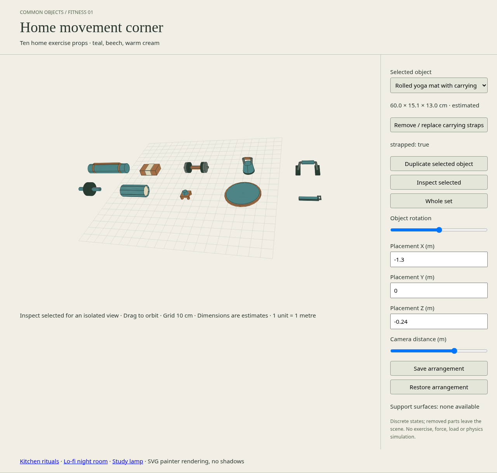

# Home movement corner — 2026-11-01 19:00 UTC

10/10 distinct props accepted; catalog total 120. No color-only variants counted.

## Scope and provenance

Started from clean work branch c3432c115fd33eca90027eb21ec0eecb2a1350be, equal to freshly fetched origin/main. No existing November 1 batch, uncommitted work, or production process was found. Read root AGENTS.md, README and asset-spec; no repository .agents skills exist. Original generated CC0 geometry; existing renderer and source/behavior/preview separation retained.

All dimensions are estimates, not manufacturer measurements. Coordinates are metres, Y-up, ground contact centered, scale [1,1,1]. Exact rest bounds, conservative footprint, fixed part IDs/pivots/reference axes, state visibility and conditional horizontal support patches are in each asset.json. Camera fitting changes no physical scale.

| Object | Width × height × depth (cm) | Independent action |
| --- | --- | --- |
| Twin disc abdominal roller | 32.0 × 17.0 × 17.0 | Remove / replace axle grips |
| Circular balance board with removable pad | 38.0 × 6.7 × 38.0 | Remove / replace cork standing pad |
| Adjustable short dumbbell | 32.0 × 13.0 × 13.0 | Remove / replace outer weight plates |
| Hollow ribbed foam roller | 32.0 × 14.0 × 14.0 | Remove / replace inner core |
| Flat bottom kettlebell | 13.0 × 19.8 × 13.0 | Remove / replace grip wrap |
| Four foot wooden massage tool | 10.4 × 7.8 × 10.4 | Remove / replace palm knob |
| Freestanding push up bar | 24.5 × 13.4 × 16.0 | Remove / replace handle pad |
| Folded stretching strap with buckle | 20.0 × 2.8 × 5.0 | Remove / replace metal buckle |
| Cork yoga block with cotton sleeve | 23.0 × 7.7 × 15.4 | Remove / replace cotton sleeve |
| Rolled yoga mat with carrying straps | 60.0 × 15.1 × 13.0 | Remove / replace carrying straps |

## Validation

- npm run validate: 120 catalog entries pass.
- npm test: 53/53 pass, including three fitness geometry/state/support tests.
- npm run build: pass.
- scripts/fitness-check.mjs: all ten exact geometry bounds and both states recorded in [validation JSON](fitness-validation-result.json).
- scripts/fitness-browser-check.py: Chromium desktop 1280px and mobile 390px, four rotations per prop, alternate states, ten independent duplicates, unit scale, orbit/zoom and 20-instance persistence pass; no HTTP or page errors. [Browser results](fitness-browser-result.json).
- Yoga block placed on balance board at Y=0.067 m; alternate bare board support at 0.063 m checked numerically. Shared scene occlusion inspected.
- Actual image pixels inspected: four-side/alternate contact sheet, desktop arrangement, support placement and mobile detail. Mat carrying handle anchors were added after inspection; final captures regenerated. No clipped or detached parts observed in the reviewed final views.

## Deliverables

Sources and individual SVG thumbnails: assets/fitness-*/. Reproducible source: scripts/batches/fitness-2026-11-01.mjs. [Interactive preview](../preview/fitness.html).

[All four sides and states](screenshots/fitness-2026-11-01/inspection-contact-sheet.jpg) · [Support placement](screenshots/fitness-2026-11-01/support-placement.png) · [Mobile](screenshots/fitness-2026-11-01/mobile-detail.png). Original PNG captures retained in the same directory.

## Limits

These are metric SVG projected props, not exported GLB meshes. Simplified solid or single-surface shells; no material thickness simulation, exercise motion, force, load rating, collisions, shadows or general physical behavior. Actions remove components discretely. Support patches are geometric hints, not stability guarantees. Balance board is fixed upright for decoration. The mat stays rolled, and the strap stays folded. The repository has no .github/workflows CI configuration; local checks are the validation evidence, not a claimed hosted CI pass.
