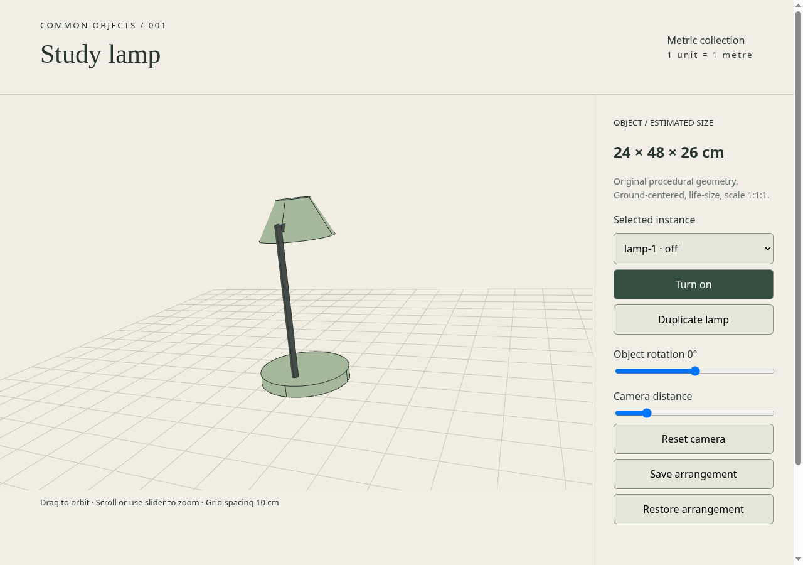
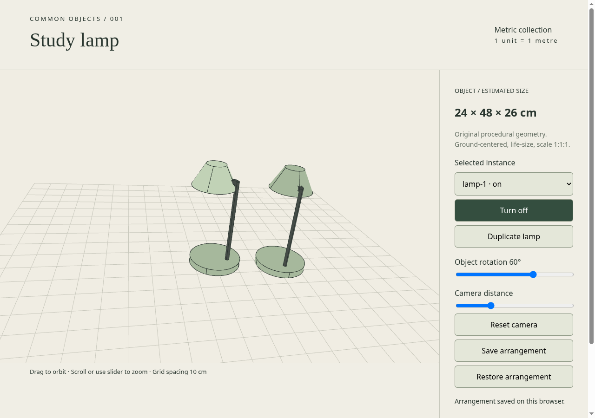
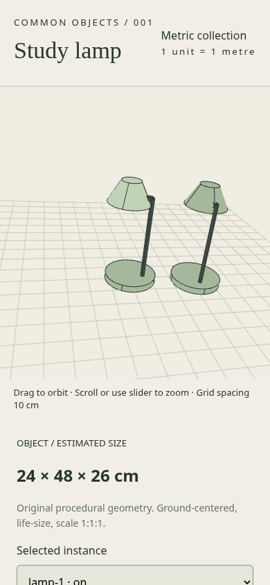

# Pilot validation

Validated 2026-10-23 in Chromium headless with SwiftShader (software WebGL), at 1280×900 and 390×844.

Passed:
- Catalog/metric contract, generated geometry bounds and conservative footprint.
- Six Node tests: independent state/transforms, scene round trip, invalid inputs and rotation.
- Static build without dependencies.
- Browser load with no JavaScript exceptions or WebGL errors.
- Switch, independent duplicate state (first on, second off), object rotation, zoom slider, camera pointer drag, save and restore.
- Narrow viewport without horizontal overflow.
- Desktop, duplicated scene and mobile screenshots visually inspected.

Not tested: real mobile GPUs, large-scene frame budgets, cross-browser behavior, physically accurate illumination, multi-type catalog UI, articulated joints. The lamp's shade and bulb brighten when switched on; there is no dynamic light/shadow simulation. Current screenshots are reproducible evidence, not performance measurements.

To repeat browser checks, serve the build at port 8000, run Chromium with remote debugging on port 9222, then `node scripts/browser-check.mjs`. The script overwrites screenshots in docs/screenshots. Use an isolated Chromium profile; headless CI may require software WebGL flags.

