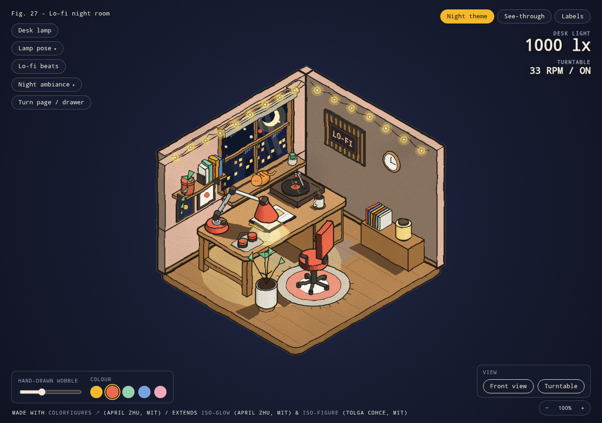
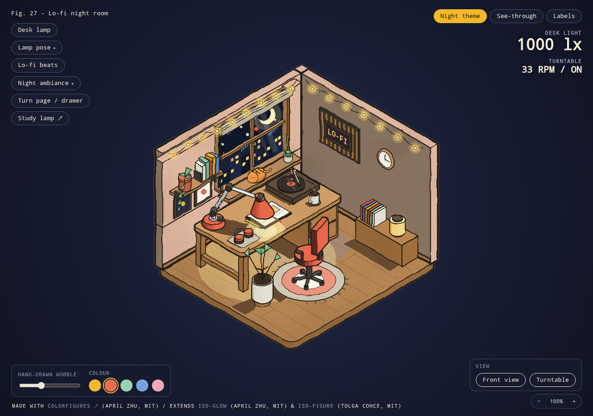
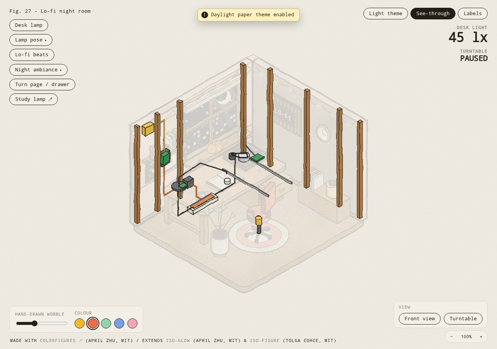
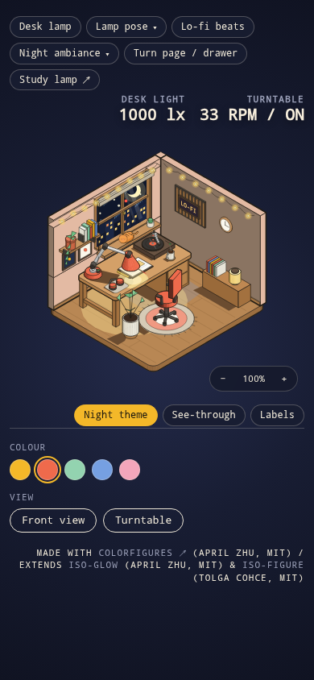
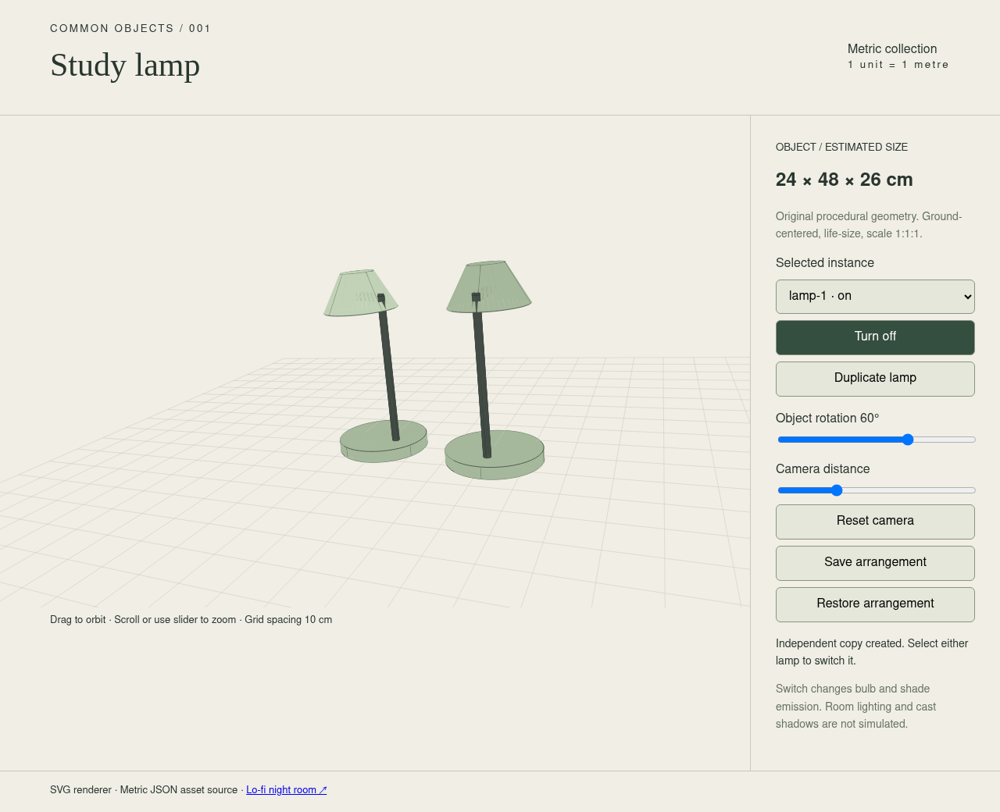
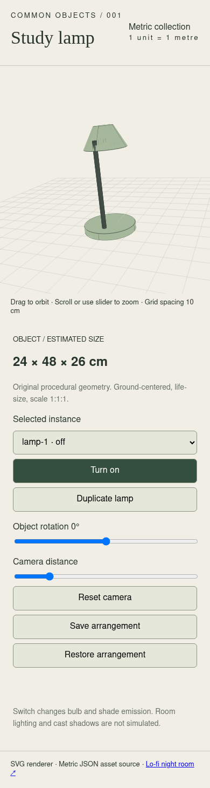
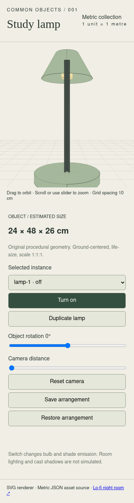

# SVG import validation

Checked 2026-10-24 (Asia/Seoul), Node.js 22 and headless Chromium on Linux.

- `npm run validate`: all 20 catalog entries, metric lamp bounds and SVG source definitions pass.
- `npm test`: 12 tests pass, including source-script reconstruction, all component registrations, independent SVG lamp state, invalid SVG descriptors, and restoring existing v1 arrangements. Required import cases and legacy restore were observed failing before implementation.
- `npm run build`: static output created in dist/. No dependencies or generated dist files are committed.
- Built room initial SVG art equals the immutable published r2 art byte for byte. Source and port desktop captures were opened and compared; the room geometry, corner HUD and spacing match, with one collection link added using the existing action-button style.
- Built room controls exercised: lamp switch/glow, pose menu, turntable on/off, drawer, Night/Light theme, see-through, labels, 125% zoom. Desktop and 390×844 mobile captures were opened; no horizontal overflow on mobile. Keyboard orbit was checked on mobile. The attempted desktop drag began on an actionable prop; the source correctly consumed that gesture as an object action. Camera mouse dragging was not independently confirmed in this run.
- Built study lamp uses SVG paths and no canvas. At 1280×900 and 390×844, the existing header, controls and spacing are preserved. Independent copies save as on/off, selected rotation changes to 60°, zoom changes to 1.6, and save/restore recovers the arrangement. The two players are reachable through their actual links.
- Console/page errors and HTTP failures: zero in the successful remaining-flow run. Detailed result: browser-result.json. Earlier room controls and source-parity evidence came from the preceding browser run; completed checks were not repeated.

The scripted browser check owns its local HTTP server and Chromium. Run `npm run browser-check` for all flows; `python3 scripts/browser-check.py --remaining` checks the narrow room and lamp flows. Python Playwright and its Chromium installation are required for this optional browser check; no npm package is installed. On the shared host use the common heavy-work runner.

## Captures

## Limits

SVG uses painter sorting, so intersecting surfaces and lines can show ordering artifacts. This is not shared-depth WebGL rendering. All catalog placement data now uses metres/Y-up. The imported room uses the documented shared 0.75 m desk-height estimate; raw drawing coordinates are preserved separately. The study lamp retains its original estimated metre geometry. Real-device, cross-browser and large-scene performance were not tested. Drawn light effects are illustrative. Imported typography and CSS, including the existing lamp layout, are preserved; no new size tokens are introduced.

## Metric placement follow-up

A later user instruction required every placeable asset to use 1 unit = 1 m. Imported descriptors v2 now provide metre dimensions/bounds/footprints, one shared physical calibration, reversible right-handed axis conversion and the original assembly in metre positions. Version 1 descriptors remain archived. The calibration assumes a 0.75 m worktop above the source finished floor (z=33 minus z=5). The original projected player artwork is unchanged.

The missing placement API was observed RED before implementation. Targeted calibration, source-axis directions, inverse round trip, every imported group's metric envelopes/assembly position, the existing 0.48 m lamp and stored assembly unit scales passed. After adding open-drawer clearance, the affected three contract checks passed again. The final catalog validator accepts all 20 entries. Prior source parity, lamp state/persistence and browser flow evidence remains valid because the rendering/player paths did not change. See metric-placement.md for assumptions and every estimated envelope.

## SVG near-plane correction

The default lamp view put a far grid corner behind the camera (view z = +0.003954 m). Dividing that endpoint by negative depth mirrored a ground line into the upper-right background. SVG lines now clip against the same 0.01 m near plane as the original metric WebGL renderer before projection; asset geometry, metre calibration and room rendering are unchanged.

The closest-zoom ground-grid regression failed before the change. Afterward it and the existing SVG independent-state/rotation/zoom test passed (2 tests). The incremental build succeeded. A scoped Chromium check exercised actual pointer orbit at camera distance 0.65, checked every grid endpoint below the level-camera horizon, and recorded zero console/page errors or HTTP failures (projection-result.json). Updated desktop/mobile lamp captures were opened; the stray diagonal is gone, with the existing layout and controls preserved. The near-plane capture below shows the closest-zoom check. Existing room and persistence evidence is reused.

